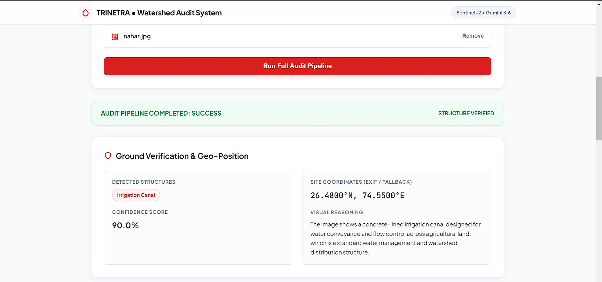
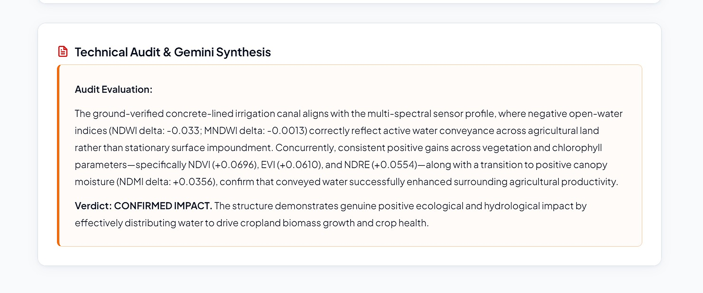
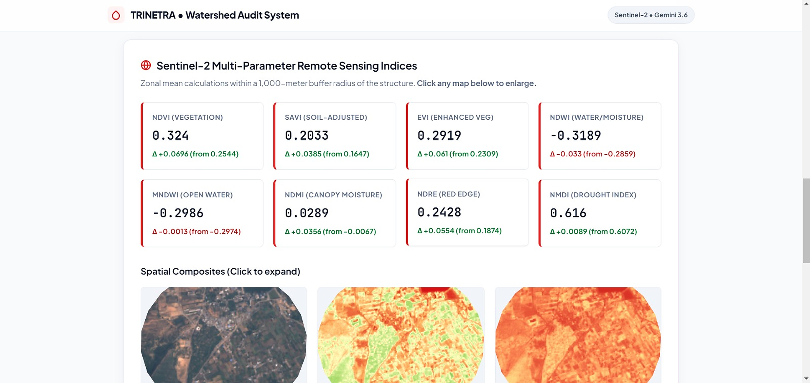

🌍 TRINETRA — AI-Powered Watershed Monitoring & Impact Assessment

  <strong>Seeing Beyond the Surface. Measuring Environmental Change.</strong>
   
  An AI-assisted geospatial platform for watershed structure verification and satellite-based environmental monitoring.

  
  
  
  
  
  

---

## 🚀 About Trinetra

**Trinetra** is an AI-powered watershed monitoring and environmental impact assessment platform developed for Smart India Hackathon 2026.

The project aims to transform traditional watershed monitoring by integrating ground-level field photographs with Artificial Intelligence and satellite-based geospatial analysis.

Monitoring watershed development structures manually is time-consuming, while field photographs and satellite observations are often analyzed separately. Trinetra bridges this gap through an integrated workflow that verifies watershed structures using Google Gemini AI and evaluates surrounding environmental indicators using Google Earth Engine and Sentinel-2 satellite imagery.

By combining AI-based structure verification with multi-temporal satellite analysis, Trinetra generates meaningful environmental insights through a unified dashboard.

**Our objective is to make watershed monitoring more intelligent, data-driven, transparent, and scalable.**

---

## 🎯 Problem Statement

Traditional watershed monitoring faces several challenges:

- Manual inspection of watershed development structures requires significant time and resources.
- Geotagged field photographs are not fully utilized for geographical analysis.
- Ground-level observations and satellite data are often disconnected.
- Evaluating pre- and post-development vegetation and water changes is difficult.
- Monitoring authorities lack an integrated platform for understanding environmental impact.

### Our Solution

Trinetra combines AI-based image verification, EXIF metadata extraction, and satellite-based environmental analysis to provide a unified monitoring and assessment workflow.

---

## ✨ Key Features

| Feature | Description |
|---|---|
| 📸 Field Image Upload | Upload photographs of watershed development structures. |
| 🤖 AI Structure Verification | Google Gemini identifies and verifies watershed structures. |
| 📍 GPS Extraction | Extract latitude and longitude from image EXIF metadata. |
| 🛰️ Satellite Analysis | Retrieve Sentinel-2 satellite imagery using Google Earth Engine. |
| 🌱 Vegetation Monitoring | Calculate NDVI, SAVI, EVI and NDRE indicators. |
| 💧 Water & Moisture Analysis | Calculate NDWI, MNDWI, NDMI and NMDI indicators. |
| 📊 Pre/Post Comparison | Compare satellite-derived environmental indicators across time periods. |
| 🧠 AI Interpretation | Generate an expert-style textual assessment using Gemini. |
| 📈 Dashboard Visualization | Display verification details, environmental metrics and analysis results. |

---

## 🏗️ System Architecture

Trinetra follows an integrated AI and geospatial processing architecture.

## 🖥️ Application Preview

### 1. Ground Verification & Geo-Position

### 2. Technical Audit & Gemini Synthesis

### 3. Sentinel-2 Remote Sensing Analysis

---

### Workflow

    flowchart TD
        A["Field Photograph Upload"] --> B["FastAPI Backend"]
        B --> C["Google Gemini AI"]
        C --> D{"Watershed Structure Valid?"}
        D -->|No| E["Rejected Response"]
        D -->|Yes| F["EXIF GPS Extraction"]
        F --> G["Resolve Analysis Coordinates"]
        G --> H["Google Earth Engine"]
        H --> I["Sentinel-2 Satellite Imagery"]
        I --> J["Pre/Post Satellite Composites"]
        J --> K["Calculate Spectral Indices"]
        K --> L["Environmental Metrics & Delta"]
        L --> M["Gemini AI Interpretation"]
        M --> N["JSON Audit Response"]
        N --> O["Trinetra Dashboard"]

### Execution Pipeline

**1. Image Upload**

- User uploads a field photograph through the web interface.
- The frontend sends the image to the FastAPI backend.

**2. AI-Based Structure Verification**

- Google Gemini analyzes the uploaded photograph.
- Identifies potential watershed development structures.
- Returns verification status, detected structure categories, confidence score and reasoning.
- Invalid images are rejected before satellite analysis.

**3. EXIF Metadata Extraction**

- Pillow and piexif process image metadata.
- GPS latitude and longitude are extracted when available.
- Coordinates are used to identify the geographical analysis location.

**4. Satellite Data Retrieval**

- Google Earth Engine retrieves Sentinel-2 Harmonized imagery.
- The backend generates seasonal satellite composites for the comparison periods.

**5. Environmental Analysis**

- Eight spectral indices are calculated.
- Pre-development and post-development indicator values are compared.
- Delta values are generated to represent observed changes.

**6. AI-Based Interpretation**

- Gemini combines the structure-verification information with satellite-derived metrics.
- Generates a textual environmental assessment.

**7. Dashboard Visualization**

- The backend returns structured JSON.
- The frontend displays verification results, coordinates, environmental metrics, satellite visualizations and assessment details.

---

## 🛰️ Geospatial Analysis

Trinetra integrates **Google Earth Engine (GEE)** with Sentinel-2 Harmonized satellite imagery for environmental monitoring.

The current implementation compares two fixed seasonal windows:

- **Pre-comparison period:** 1 October – 30 November 2017
- **Post-comparison period:** 1 October – 30 November 2021

The backend calculates eight spectral indices.

### Spectral Indices Used

| Index | Full Form | Application |
|---|---|---|
| NDVI | Normalized Difference Vegetation Index | Vegetation health and greenness |
| SAVI | Soil Adjusted Vegetation Index | Vegetation analysis with soil adjustment |
| NDWI | Normalized Difference Water Index | Water-related spectral changes |
| MNDWI | Modified Normalized Difference Water Index | Surface-water feature analysis |
| EVI | Enhanced Vegetation Index | Improved vegetation monitoring |
| NDMI | Normalized Difference Moisture Index | Vegetation moisture analysis |
| NDRE | Normalized Difference Red Edge | Red-edge vegetation monitoring |
| NMDI | Normalized Multi-band Drought Index | Moisture and drought-related analysis |

### Pre/Post Comparison

For every index, Trinetra calculates:

- **Pre Value:** Mean index value for the 2017 composite.
- **Post Value:** Mean index value for the 2021 composite.
- **Delta:** Difference between post and pre values.

Formula:

    Delta = Post Value - Pre Value

Current analysis configuration:

| Parameter | Value |
|---|---|
| Satellite Dataset | COPERNICUS/S2_HARMONIZED |
| Analysis Scale | 10 metres |
| Analysis Radius | 1,000 metres |
| Comparison | 2017 vs 2021 |
| Composite Method | Median seasonal composite |

**Important:** Changes in spectral indices indicate observed environmental differences, not proof that a particular watershed structure caused those changes. Rainfall, seasonal variation, land-use changes, cloud conditions and other factors must also be considered.

---

## 🛠️ Technology Stack

| Component | Technology |
|---|---|
| Frontend | HTML5, CSS3, JavaScript |
| Backend | Python, FastAPI |
| AI Integration | Google Gemini API |
| AI SDK | google-genai |
| Image Processing | Pillow (PIL), piexif |
| Geospatial Processing | Google Earth Engine |
| Satellite Imagery | Sentinel-2 Harmonized |
| Data Validation | Pydantic |
| API Communication | REST API |
| Data Exchange | JSON |

---

## 📂 Project Structure

    SIH_2026_TRINETRA/
    │
    ├── main.py
    │
    ├── index.html
    │
    ├── static/
    │   ├── script.js
    │   └── style.css
    │
    ├── LICENSE
    │
    └── README.md

### File Responsibilities

| File | Responsibility |
|---|---|
| `main.py` | FastAPI backend, Gemini integration, EXIF extraction and Earth Engine processing. |
| `index.html` | Main web application interface. |
| `static/script.js` | Image upload, API communication and result rendering. |
| `static/style.css` | Frontend styling and dashboard presentation. |
| `README.md` | Project documentation. |

---

## ⚙️ Installation & Setup

### Prerequisites

- Python 3.10 or newer
- Git
- Google Gemini API key
- Google Earth Engine account
- Earth Engine-enabled Google Cloud project

### 1. Clone the Repository

    git clone https://github.com/AnujSharan987/SIH_2026_TRINETRA.git
    cd SIH_2026_TRINETRA

### 2. Create a Virtual Environment

    python -m venv .venv

Activate it:

**Windows:**

    .venv\Scripts\activate

**Linux / macOS:**

    source .venv/bin/activate

### 3. Install Dependencies

    pip install fastapi uvicorn python-multipart earthengine-api google-genai Pillow piexif pydantic

### 4. Configure Gemini API

Set your Gemini API key as an environment variable.

**Windows PowerShell:**

    $env:GEMINI_API_KEY="YOUR_GEMINI_API_KEY"

**Linux / macOS:**

    export GEMINI_API_KEY="YOUR_GEMINI_API_KEY"

Never upload API keys or private credentials to GitHub.

### 5. Configure Google Earth Engine

Authenticate your Google account:

    earthengine authenticate

Ensure that Earth Engine is enabled for the Google Cloud project used by the backend.

The current implementation initializes Earth Engine with the project ID:

    isro-hkt-2026

Change the project ID in `main.py` if you are using another Earth Engine-enabled project.

### 6. Run the Application

    uvicorn main:app --reload

Open the application:

- **Web Application:** http://127.0.0.1:8000/
- **FastAPI Documentation:** http://127.0.0.1:8000/docs

---

## 🔌 API Documentation

### POST `/verify-and-analyze`

This endpoint accepts an uploaded photograph and executes the complete verification and geospatial analysis pipeline.

**Request Type:** `multipart/form-data`

| Parameter | Type | Description |
|---|---|---|
| file | Image | Uploaded watershed field photograph |

### Response Overview

The successful API response contains:

- Processing status.
- Watershed structure verification.
- Detected structure categories.
- AI confidence score and reasoning.
- Geographical coordinates.
- Eight spectral index metrics.
- Satellite visualization URLs.
- Final AI-generated assessment.

Example response structure:

    {
      "status": "SUCCESS",
      "is_valid_watershed_structure": true,
      "verification_details": {
        "is_watershed_structure": true,
        "detected_structures": ["Check Dam"],
        "confidence_score": 0.92,
        "reasoning": "Illustrative verification result."
      },
      "coordinates": {
        "latitude": 28.679916,
        "longitude": 77.509619
      },
      "gee_metrics": {
        "metrics": {},
        "image_urls": {}
      },
      "final_evaluation": "Illustrative assessment."
    }

*The example values are illustrative, not actual measured results. The real response contains the calculated index metrics and generated image URLs.*

---

## ⚠️ Current Limitations

Trinetra is currently a working prototype, and the following limitations should be considered:

1. **GPS Fallback:** If EXIF GPS metadata is unavailable, the current implementation uses a predefined fallback coordinate. Satellite results may therefore not represent the actual photograph location.
2. **Fixed Time Periods:** Satellite comparison currently uses fixed 2017 and 2021 seasonal windows rather than dynamically selecting periods based on the photograph timestamp.
3. **Timestamp Extraction:** The current metadata extraction workflow focuses on GPS coordinates; capture-time-based comparison is not yet implemented.
4. **AI Confidence:** Gemini-generated confidence scores are not independently calibrated probabilities.
5. **Environmental Attribution:** Spectral index changes alone cannot establish a direct causal relationship between a structure and environmental improvement.
6. **Production Readiness:** Authentication, upload restrictions, rate limiting, deployment configuration and additional security hardening are still required for production deployment.

---

## 🔮 Future Scope

We plan to enhance Trinetra with:

- [ ] React-based frontend architecture.
- [ ] Advanced computer vision models for watershed structure classification.
- [ ] Dynamic satellite comparison based on image timestamps.
- [ ] Interactive GIS maps and geographical visualizations.
- [ ] Historical monitoring and audit records.
- [ ] Automated environmental impact reports.
- [ ] Multi-region and district-level monitoring.
- [ ] Improved impact scoring with domain-expert validation.
- [ ] Database integration for persistent monitoring records.
- [ ] Enhanced image verification using validated datasets.

---

## 🌏 Real-World Applications

Trinetra has potential applications in:

- Government watershed development monitoring.
- Water conservation and management programs.
- Environmental impact assessment.
- Rural development projects.
- NGO-led watershed restoration initiatives.
- Regional and district-level environmental monitoring.

The platform aims to support evidence-informed decision-making by connecting field observations with satellite-derived environmental indicators.

---

## 🤝 Contributing

Contributions and suggestions are welcome!

1. Fork this repository.
2. Create a new feature branch.
3. Implement your changes.
4. Commit and push your changes.
5. Submit a Pull Request.

---

## 📜 License

This project is licensed under the MIT License. See the [LICENSE](LICENSE) file for details.

---

  <strong>🌍 TRINETRA</strong>
   
  Seeing Beyond the Surface. Measuring Environmental Change.
    
  <em>Transforming field observations into actionable geospatial intelligence.</em>

